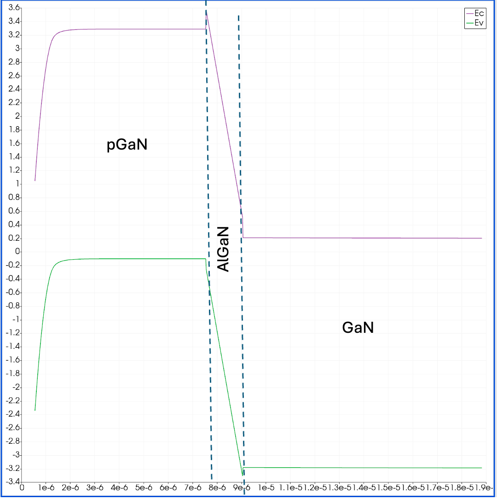

# p-GaN gate HEMT at equilibrium with DEVSIM

A minimal 2D TCAD model of a **normally-off p-GaN gate GaN HEMT**, built only with open-source
tools: the device simulator [DEVSIM](https://devsim.org), the mesh generator [Gmsh](https://gmsh.info)
and [ParaView](https://www.paraview.org) for visualization.

## Why a p-GaN gate?
In an AlGaN/GaN heterostructure the polarization of the strained AlGaN barrier induces a
two-dimensional electron gas (2DEG) at the AlGaN/GaN interface, even without any doping:
the transistor is **on** at zero gate voltage (normally-on). Power electronics needs the
opposite, a **normally-off** switch, for fail-safe operation.

A thin Mg-doped GaN layer (p-GaN) under the gate solves this. Its negative ionized acceptors
lift the conduction band of the whole stack below it: at the AlGaN/GaN interface the
conduction band moves **above the Fermi level** and the 2DEG under the gate disappears, while
in the access regions, without p-GaN, the 2DEG stays at ~1e13 cm^-2.
This model shows exactly that, at thermal equilibrium (all contacts at 0 V).

## Results
Simulated structure: p-GaN gate on a 15 nm AlGaN barrier, on top of GaN.


Equilibrium band diagram along a vertical cut under the gate (ParaView, depth in cm).
The conduction band at the AlGaN/GaN interface sits ~0.2 eV above the Fermi level (E = 0):
no 2DEG under the gate.



## Model
- Thermal equilibrium: Poisson equation only, flat Fermi level taken as the reference (E_F = 0).
- **Boltzmann statistics** for electrons and holes, chosen for simplicity since this is a teaching example.
  Under the gate the 2DEG is depleted and non-degenerate, so Boltzmann is accurate exactly where the
  p-GaN effect is shown. In the access regions the 2DEG is degenerate: the electron profile near the
  interface is approximate, while the sheet density is set by electrostatics (the polarization charge).
  A more complete, non-public version of this model uses Fermi-Dirac statistics.
- Incomplete ionization of donors and acceptors (Mg in GaN is a deep acceptor, E_A = 0.17 eV).
- Polarization of the AlGaN barrier as fixed sheet charges at its two interfaces:
  +sigma at AlGaN/GaN and -sigma at p-GaN/AlGaN, with sigma = 1e13 cm^-2 (x_Al ~ 0.2,
  Ambacher et al., J. Appl. Phys. 85, 3222, 1999).
- Contacts: ohmic source, drain and body; ideal Schottky gate on the p-GaN (work function 5.1 eV).
- Generic, literature-based parameters: this is not the model of a specific commercial device.

Main parameters (all in `hemt/config.py`):

| layer | thickness | doping |
|---|---|---|
| p-GaN | 70 nm | Mg 3e19 cm^-3 |
| AlGaN (x_Al ~ 0.2) | 15 nm | n 1e15 cm^-3 |
| GaN | 1 um | n 1e15 cm^-3 |

Lateral dimensions (in `geometry.py`): gate length 1 um, source-gate 1 um, gate-drain 3 um.

## Limitations
This is a teaching model, kept simple on purpose:
- equilibrium only: no bias, no current, no I-V curves;
- no surface states on the free AlGaN surface, no traps, no quantum confinement.

## Files
| file | content |
|---|---|
| `geometry.py` | geometry and mesh (Gmsh) |
| `run_equilibrium.py` | main script |
| `hemt/config.py` | all physical parameters |
| `hemt/mesh.py` | mesh import into DEVSIM |
| `hemt/equilibrium.py` | Poisson equation, polarization charges, contacts |
| `figures/` | figures of this README |

## Run
```bash
python -m venv .venv && source .venv/bin/activate
pip install -r requirements.txt
python geometry.py          # creates the mesh pGaN_HEMT_simple.msh
python run_equilibrium.py   # solves Poisson, writes output/ (about 30 s)
```

## Visualize in ParaView
Open `output/hemt_equilibrium.vtm`. Available fields include `Potential`, `Ec`, `Ev`,
`Electrons`, `Holes`, `NDion`, `NAion`.
- Band diagram: filter *Plot Over Line* along a vertical line, under the gate or in the
  access region, and plot `Ec` and `Ev`. Coordinates are in cm.
- 2DEG: color by `Electrons` with a logarithmic scale.

## License
MIT, see `LICENSE`.
